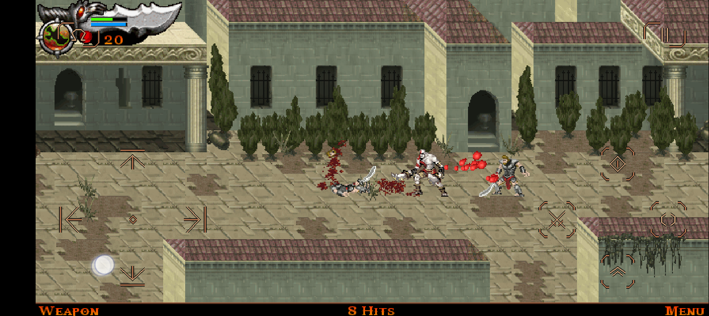
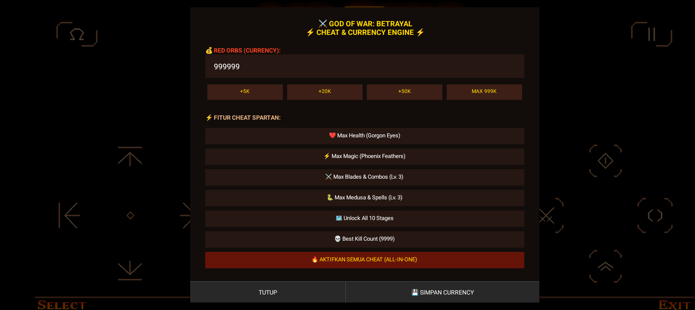

# ⚔️ God of War: Betrayal — Native Android Remastered + Cheat Engine

[](https://github.com/GUPRON98/GodOfWar-Betrayal-Android)
[](https://github.com/GUPRON98/GodOfWar-Betrayal-Android)
[](https://github.com/GUPRON98/GodOfWar-Betrayal-Android)
[](https://github.com/SupaRj/gow-betrayal-remastered-Android-Native-port)

Port Android Native berperforma tinggi dari **God of War: Betrayal (2007)** dengan dukungan **Widescreen Fullscreen**, **60 FPS Gameplay**, **On-Screen Multi-touch Controls**, dan **Interactive In-Game Cheat Engine**.

---

## 📸 Screenshots

| Gameplay 60 FPS Widescreen | In-Game Cheat & Currency Engine |
| :---: | :---: |
|  |  |

---

## ⚡ Fitur Utama

- ⚔️ **Native Performance (60 / 90 / 120 FPS)**: Berjalan mulus menggunakan engine C++ dan SDL2 tanpa emulator Java yang berat.
- 📱 **Clean Widescreen & Touch Controls**: Tampilan fullscreen landscape dengan kontrol sentuh responsif tanpa tombol berbayang.
- 🔓 **Tanpa Gangguan Izin Sistem**: Telah dioptimalkan agar tidak memicu pop-up izin *All Files Access / MANAGE_EXTERNAL_STORAGE*.
- ⚡ **Interactive In-Game Cheat Engine (`⚡ CHEAT`)**:
  - **Custom Currency / Red Orbs**: Tambah currency secara bebas (input nominal apa pun atau tombol cepat `+5K`, `+20K`, `+50K`, `MAX 999K`).
  - **❤️ Max Health**: Gorgon Eyes maksimal (bar darah penuh).
  - **⚡ Max Magic**: Phoenix Feathers maksimal (bar mana penuh).
  - **⚔️ Max Blades & Combos**: Blades of Chaos Level 3 + Combo maksimal.
  - **🐍 Max All Spells**: Medusa's Gaze & Bow of Apollo Level 3.
  - **🗺️ Unlock All 10 Stages**: Bebas memilih stage 1 sampai 10.
  - **💀 Best Kill Count 9999**.
  - **🔥 One-Click ALL-IN-ONE Cheat**.

---

## 📦 Download APK

Unduh file APK siap pasang dari bagian [Releases](https://github.com/GUPRON98/GodOfWar-Betrayal-Android/releases/latest) atau download langsung:
- **[GodOfWar.apk](https://github.com/GUPRON98/GodOfWar-Betrayal-Android/releases/download/v1.2/GodOfWar.apk)**

---

## 🎮 Cara Menggunakan Cheat Engine

1. Buka game **God of War: Betrayal**.
2. Sentuh tombol **`⚡ CHEAT`** di pojok kanan atas layar.
3. Masukkan nominal Red Orbs yang diinginkan atau pilih cheat instan.
4. Tekan **"SIMPAN CURRENCY"** atau pilih cheat yang diinginkan.
5. Perubahan akan langsung aktif di dalam permainan!

Tersedia juga script CLI untuk Termux:
```bash
python3 gow_cheat.py
```

---

## 🏛️ Credits & Attribution

Proyek ini dibuat dan disempurnakan berdasarkan karya luar biasa dari komunitas reverse-engineering:

- **[SupaRj / gow-betrayal-remastered-Android-Native-port](https://github.com/SupaRj/gow-betrayal-remastered-Android-Native-port)**: Port Android Native orisinal, implementasi SDL2, kontrol sentuh mobile, dan engine audio MIDI.
- **[samioan / gow-betrayal-remastered](https://github.com/samioan/gow-betrayal-remastered)**: Reverse-engineering bytecode Java asli (Sony Ericsson K800i MIDlet 1.4.20) dan rekonstruksi engine C++.
- **Sony Interactive Entertainment, Santa Monica Studio & Glu Mobile**: Pengembang dan pemegang hak cipta asli atas *God of War: Betrayal* (2007).

*Catatan: Proyek ini ditujukan semata-mata untuk tujuan edukasi dan preservasi sejarah game klasik mobile.*
